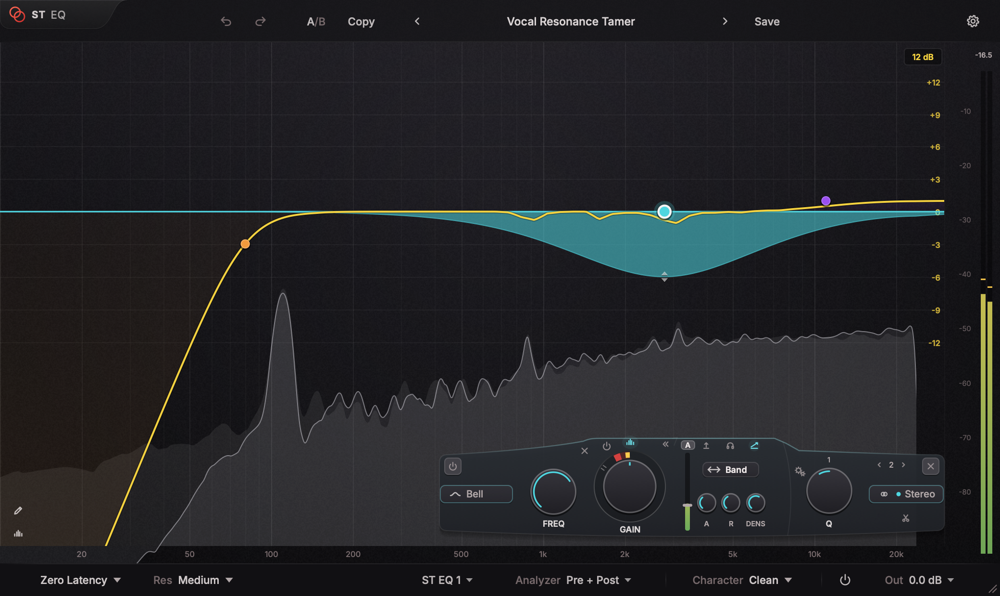

# ST EQ

24-band parametric and dynamic EQ with zero-latency, natural-phase and linear-phase processing. VST3 and AU for
macOS (Apple Silicon + Intel). Built on [st-shell](https://github.com/davidstokarski/st-shell).



## Download

**[⬇ Download ST EQ for macOS (VST3 + AU)](https://github.com/davidstokarski/st-eq/releases/latest/download/ST-EQ-macOS.zip)**
— or pick a version on the [Releases page](https://github.com/davidstokarski/st-eq/releases).

1. Copy `ST EQ.vst3` to `~/Library/Audio/Plug-Ins/VST3/` and `ST EQ.component` to `~/Library/Audio/Plug-Ins/Components/`
2. The builds are ad-hoc signed (not notarised). If macOS blocks them, run once:
   ```bash
   xattr -dr com.apple.quarantine ~/Library/Audio/Plug-Ins/VST3/"ST EQ.vst3" ~/Library/Audio/Plug-Ins/Components/"ST EQ.component"
   ```
3. Restart your DAW.

## Features

- **24 bands**, 10 shapes: Bell, Low / High Shelf, Low / High Cut, Notch, Band Pass, Tilt Shelf, Flat Tilt, All Pass
- Slopes 6–96 dB/oct plus Brickwall for every shape that has a slope; resonant cuts and shelves; Gain-Q interaction
- **Analog-matched filters**: no cramping near Nyquist in Zero Latency mode
- **Processing modes**: Zero Latency, Natural Phase (analog magnitude *and* phase, ~2.7 ms latency at 48 kHz),
  Linear Phase (Low … Maximum resolution, 4k–64k taps)
- **Per-band stereo placement**: stereo, left, right, mid, side — split a band into L/R or M/S pairs in one click
- **Dynamic EQ** on every bell / shelf / tilt band: drag the ring around Gain (or the ▲▼ handle in the display) for
  the range; the island's dynamics tab expands in place with an auto / manual threshold meter, attack / release,
  band or free trigger range (drag its handles in the display), external side chain and audition
- **Spectral dynamics**: switch a dynamic band to spectral (the bars icon on its dynamics tab, Alt-Shift-click to
  create one, or the band menu) and each frequency inside it is compressed / expanded on its own — resonances that
  come and go are tamed without touching the rest of the band. Density and Tilt in the expanded section;
  linear phase (adds the processing resolution's FFT size of latency)
- **Multiview** (centre of the bottom bar): every ST plug-in in the session, covering the whole plugin window — a row
  per track with its name and colour and each ST plug-in on it as a module side by side (ST EQ first, then ST Sat...),
  all editable from here; the row under the mouse grows; zoom, search, pinning, a track list that shows what's in
  view; EQ modules of tracks that collide with this one glow red
- **Collisions**: where this track and the others are loud at the same frequencies the analyser turns red
- **Parameter display**: hover a dot for live values (drag, wheel or double-click them) and quick buttons — shape,
  bypass, delete, and headphones: click and hold to solo the band, drag while listening to move it
- **EQ Sketch**: draw the curve you want; bands appear while you draw
- **EQ Match**: learn a reference (side chain, or another ST EQ instance) and match your track to it, with detail,
  amount and band count
- **Analyzer**: pre, post and side chain, range, resolution, speed, tilt, Freeze (builds a maximum), collisions;
  **Spectrum Grab** (hover the spectrum, grab a peak); 88-key piano display with note snapping
- Character modes (Clean / Subtle / Warm), global bypass (latency compensated), output panel (gain with pan ring,
  left/right or mid/side pan, Gain Scale, Auto Gain, polarity), output meter; channel curves in colour
  (left white, right red, mid green, side blue)
- Automatic EQ scale: fits your bands (3–30 dB), grows while you drag a node past the edge and shrinks back when
  there's room (or pick a fixed 3 / 6 / 12 / 30 dB); presets, A/B, undo / redo, copy / paste bands, resizable UI, native menus

## Mouse and keys

| Action | Gesture |
|---|---|
| Create a band | double-click the display (far left / right = cuts, below the range = notch), or drag the curve (ends = shelves) |
| Move / gain | drag a dot (Shift = fine, Alt = lock axis); multiple selected bands move together |
| Q | mouse wheel over a dot (cut filters: slope steps), Cmd-drag |
| Dynamic range | Alt + wheel, drag the range handle, or drag the ring around Gain |
| Select | click, Cmd-click to add, Shift-click for a range, drag a rectangle; Cmd-A all |
| Bypass / shape / slope | Alt-click / Cmd-Alt-click / Alt-Shift-click a dot |
| Type a value | double-click a dot or a knob (Hz, `2k`, notes like `A4`, `C#2+13`; gains also `2x`, `50%`; Tab for gain and Q) |
| Reset a knob | Cmd-click (or Alt-click) |
| Solo a band | hold the headphones in the parameter display; drag to move the band while listening |
| Spectral band | Alt-Shift-double-click / drag the curve, or "Spectral Dynamics" in the band menu |
| Delete | Delete / Backspace, × on the band island |
| Copy / paste | Cmd-C / Cmd-V, or right-click |

## Build

Expects `../st-shell` next to this repo (otherwise fetched) and JUCE 9.0.5 in `../.st-deps/JUCE-9.0.5`.

```bash
cmake -S . -B build -G Ninja -DCMAKE_BUILD_TYPE=Release -DSTEQ_BUILD_TESTS=ON
cmake --build build
./build/tests/StEqPluginTests_artefacts/Release/StEqPluginTests                     # tests
./build/tests/StEqPluginTests_artefacts/Release/StEqPluginTests --snapshot /tmp/snaps  # UI renders
auval -v aufx Steq StAu
```

Release: `scripts/release.sh` (bump `project(... VERSION x.y.z)` first).
